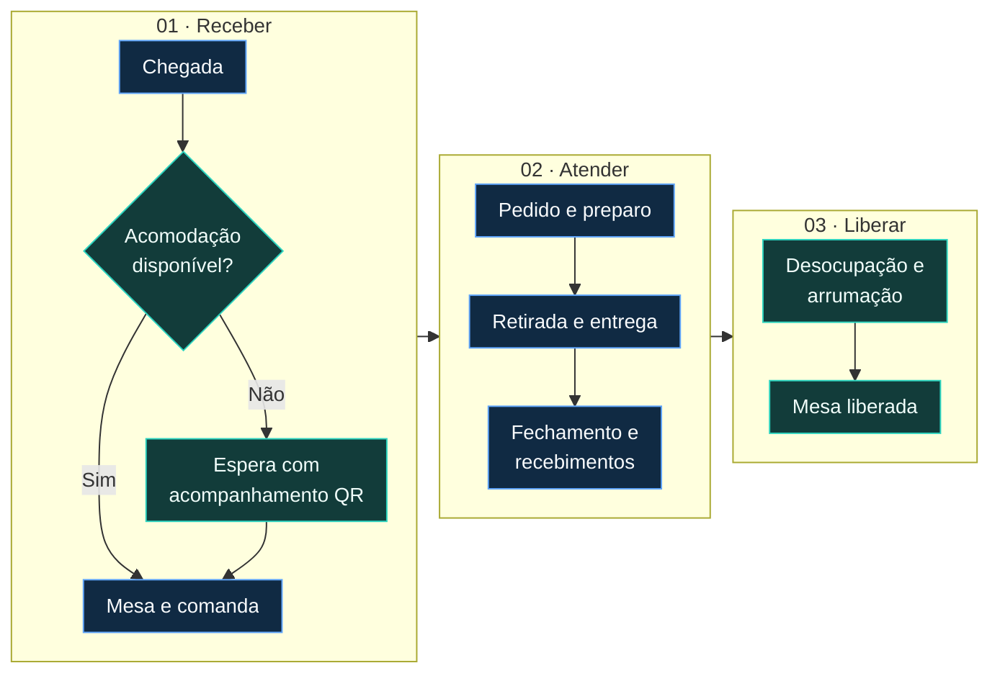
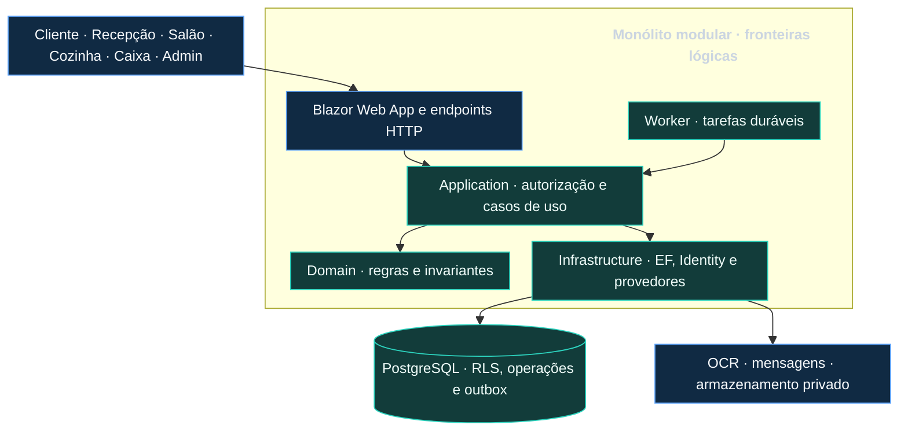

<div align="center">

<a href="https://dotnet.microsoft.com/"></a>
<a href="https://learn.microsoft.com/dotnet/csharp/"></a>
<a href="https://dotnet.microsoft.com/apps/aspnet/web-apps/blazor"></a>
<a href="https://mudblazor.com/"></a>
<a href="https://www.postgresql.org/"></a>
<br />
<a href="https://learn.microsoft.com/ef/core/"></a>
<a href="https://www.docker.com/"></a>
<a href="https://opentelemetry.io/"></a>
<a href="https://xunit.net/"></a>
<a href="https://playwright.dev/"></a>

<br /><br />


<p><strong>Comandas digitais e de papel em uma operação conectada.</strong><br />
SaaS para restaurantes, bares, casas de eventos e iniciativas beneficentes.</p>


<p>
<a href="#o-produto">Produto</a> ·
<a href="#escopo-do-mvp">MVP</a> ·
<a href="#stack-tecnologica">Stack</a> ·
<a href="#arquitetura">Arquitetura</a> ·
<a href="#infraestrutura">Infraestrutura</a> ·
<a href="#desenvolvimento">Desenvolvimento</a> ·
<a href="#documentacao">Documentação</a>
</p>

</div>

> **Estado do projeto · novembro de 2026**
>
> O ComandaFácil está na etapa de especificação e preparação da implementação. A fundação técnica está detalhada; os contratos dos demais módulos serão refinados antes de suas tarefas. As tecnologias e funcionalidades apresentadas abaixo descrevem o produto planejado. Ainda não há uma versão executável do MVP nem deploy de produção homologado.

<a id="o-produto"></a>

## O produto

O **ComandaFácil** organiza o atendimento do primeiro contato ao fechamento: recepção, lista de espera, acomodação, pedidos, cozinha, entrega e recebimentos. Cada estabelecimento mantém seus dados, equipe e configurações em um ambiente próprio dentro da plataforma.

O cliente usa o navegador do celular, acessando o atendimento por QR code. A equipe trabalha em interfaces adaptadas a cada função. Comandas de papel continuam fazendo parte da operação, com fotografia e conferência por OCR ou digitação manual.

A solução atende tanto o **dia regular de um estabelecimento** quanto um **evento pontual**: restaurante, bar, balada, casamento, bingo, bazar e outros atendimentos com mesas e consumo. Uma jornada pode atravessar a meia-noite sem perder sua data operacional ou misturar contas de dias diferentes.

<table>
<tr>
<td width="33%" valign="top">
<strong>01 · Receber</strong><br /><br />
Mapa de mesas, lugares, compartilhamento e espera. Sugestões de acomodação com confirmação humana e atenção aos grupos maiores.
</td>
<td width="34%" valign="top">
<strong>02 · Atender</strong><br /><br />
Pedidos individuais ou do grupo, preparo e entrega por quantidade. Cliente e equipe acompanham o mesmo atendimento.
</td>
<td width="33%" valign="top">
<strong>03 · Fechar</strong><br /><br />
Rateio, múltiplas formas de pagamento, saída antecipada e relatório. Consumo, desconto, recebido e dívida têm registros distintos.
</td>
</tr>
</table>

### Origem e experiência prática

O produto nasceu do piloto Batuara.net, cujo fluxo de comandas de papel foi utilizado em operação real, com o uso do OCR Google no processamento de comandas de papel. Essa experiência orienta a implementação dos fluxos do ComandaFácil.

A validação do piloto não equivale à homologação do novo SaaS: isolamento entre estabelecimentos, concorrência, persistência de tarefas e recuperação serão implementados e testados na arquitetura do produto. A extração específica de formas e valores de pagamento pelo OCR ainda exige validação própria com fotos reais.

<a id="escopo-do-mvp"></a>

## Escopo do MVP

| Frente | Entrega prevista na primeira versão |
|---|---|
| **Recepção e espera** | Mapa completo, fila, acompanhamento por QR, chamado pela aplicação, resposta de aproximação e pedidos na espera conforme configuração do estabelecimento |
| **Mesas e ocupação** | Capacidade, uso exclusivo ou compartilhado, solicitações de agrupamento/divisão, transferências e liberação após arrumação |
| **Clientes e grupos** | Comanda individual ou compartilhada, pedidos atribuídos aos participantes, responsável transferível e recuperação de acesso |
| **Pedidos e cozinha** | Cardápio, observações, itens sem preparo, preparo parcial, orientação para servir pratos juntos, retirada e entrega por quantidade |
| **Atendimento e contestação** | Chamados, cancelamento conforme estágio, resolução pelo responsável operacional e histórico de autoria |
| **Papel, foto e OCR** | Captura, conferência, digitação manual, rascunhos recuperáveis, fechamento individual ou em lote e controle durável de uso do OCR |
| **Fechamento** | Divisão entre pessoas, múltiplas formas, pagamento conjunto de comandas e recebimento na saída antecipada de participantes |
| **Caixa e relatórios** | Desconto autorizado no caixa, resumo por origem, recebido por operador/forma e fechamento A4 com opção de salvar em PDF |
| **Comunicação específica** | WhatsApp para confirmação de celular e aviso de dívida com prévia e confirmação do operador |
| **Operação segura** | Isolamento por tenant, auditoria, retenção, backups, observabilidade e recuperação antes do lançamento |

### Regras que orientam o atendimento

- **Pessoa, grupo, mesa e comanda são conceitos distintos.** Compartilhar uma mesa não torna desconhecidos integrantes da mesma conta.
- **O pagamento habitual acontece ao final.** Recebimento anterior ao encerramento do grupo atende a saída antecipada de participantes.
- **Preço lançado é preservado.** Desconto acontece no fechamento pelo caixa, quando habilitado pelo tenant; zeramento exige justificativa.
- **Pagamento não libera a mesa automaticamente.** Desocupação, arrumação e liberação física têm controle próprio.
- **Encerramento não significa quitação.** No fim do dia ou evento, saldo não pago permanece identificado na jornada original.
- **Comunicação operacional acontece na aplicação.** A fila usa consultas periódicas; WhatsApp tem finalidades específicas.

### Jornada do atendimento



Pedidos durante a espera usam a mesma comanda e o fluxo normal de preparo/entrega, quando habilitados. A acomodação atualiza o destino das quantidades ainda não entregues. O diagrama mostra o percurso habitual; saídas parciais e pendências financeiras seguem suas regras próprias.

<a id="stack-tecnologica"></a>

## Stack tecnológica

**Baseline especificada:** versões principais abaixo; patches, ferramentas e imagens serão fixados e verificados na implementação da fundação.

| Camada | Tecnologia | Papel na solução |
|---|---|---|
| Linguagem e runtime | **C# 14 · .NET 10 LTS** | Núcleo e aplicações em C# |
| Interface web | **Blazor Web App · Interactive Auto** | Interactive Server no primeiro acesso sem bundle disponível; WASM em acessos posteriores elegíveis |
| Componentes | **MudBlazor · Razor Class Library** | Componentes responsivos compartilhados entre as interfaces |
| Backend | **ASP.NET Core 10** | Endpoints HTTP, autenticação e composição dos casos de uso |
| Identidade | **ASP.NET Core Identity** | Equipe, credenciais protegidas e autorização contextual |
| Persistência | **EF Core 10 · Npgsql** | Mapeamento, transações e acesso ao PostgreSQL |
| Banco | **PostgreSQL 18 · Row-Level Security** | Persistência transacional e isolamento adicional por tenant |
| Validação | **FluentValidation** | Contratos de entrada e mensagens de validação |
| OCR | **Google/Gemini**, por interface de provedor | Extração assistida com conferência humana e controle de uso |
| Mensagens | **Evolution API**, por interface de canal | Verificação de celular e comunicação específica de conta pendente |
| Observabilidade | **OpenTelemetry** | Logs, métricas e rastreamento |
| Testes | **xUnit · Playwright** | Unidade, arquitetura, integração e fluxos de navegador |
| Empacotamento | **Docker · Docker Compose** | Ambientes locais e desenho de implantação reproduzível |

**Financeiro determinístico:** totais e alocações são calculados em C#, com precisão de centavos. O modelo de linguagem sugere dados extraídos; não decide saldo, desconto ou pagamento.

<a id="arquitetura"></a>

## Arquitetura

### Monólito modular com processos de trabalho duráveis

O núcleo mantém regras e transações coesas, com módulos separados por responsabilidade. Web e Worker pertencem à mesma solução e ciclo de versão. Trabalho assíncrono usa persistência, limites de concorrência e idempotência.



| Módulo | Responsabilidade |
|---|---|
| Plataforma e acesso | Tenant, configuração de plano/uso, identidade, papéis e vínculos |
| Jornadas | Evento, atendimento regular, data operacional e encerramento |
| Cardápio e mesas | Catálogo, disponibilidade, QR e configuração física |
| Recepção e ocupação | Espera, acomodação, solicitações ao salão e arrumação |
| Comandas e atendimento | Participantes, pedidos, preparo, entrega e contestação |
| Financeiro | Recebimentos, alocações, descontos e fechamento |
| Papel e OCR | Captura, conferência, lote e uso do provedor |
| Relatórios, comunicação e privacidade | Resumos, avisos, retenção e auditoria |

### Isolamento e consistência

- Contexto de tenant validado por operação, combinado com **filtro EF e RLS no PostgreSQL**.
- Autorização no servidor por papel, vínculo à jornada e acesso ao recurso; a UI não é a barreira de segurança.
- Transações, constraints e controle de concorrência para lugares, números e recebimentos.
- Operações idempotentes e tarefas duráveis para retomar sem multiplicar efeitos.
- Chaves separadas por finalidade e persistência de dados recuperáveis fora da memória do circuito.

**Escala por evidência:** múltiplas instâncias e processos de trabalho podem ser usados conforme a carga medida. Extração de microserviços depende de gargalos e fronteiras comprovados; não faz parte da baseline inicial.

### Organização planejada da solução

```text
src/
├── ComandaFacil.Web/             # HTTP, Blazor e composição
├── ComandaFacil.Web.Client/      # execução WebAssembly
├── ComandaFacil.Ui/              # biblioteca Razor compartilhada
├── ComandaFacil.Contracts/       # contratos de transporte
├── ComandaFacil.Domain/          # regras e tipos de domínio
├── ComandaFacil.Application/     # casos de uso e interfaces
├── ComandaFacil.Infrastructure/  # persistência e integrações
└── ComandaFacil.Worker/          # processamento durável

tests/
├── ComandaFacil.UnitTests/
├── ComandaFacil.ArchitectureTests/
├── ComandaFacil.IntegrationTests/
└── ComandaFacil.E2ETests/
```

Essa estrutura é o desenho da fundação; os projetos ainda serão criados.

<a id="infraestrutura"></a>

## Infraestrutura

### Destino previsto e serviços de apoio

| Componente | Direção definida | Situação |
|---|---|---|
| Domínio | **comandafacil.cloud** | Registro na Hostinger informado pelo responsável |
| DNS e borda | **Cloudflare** | Configuração informada; rota, TLS e origem serão conferidos na implantação |
| Hospedagem | **Shard Cloud** | Destino pretendido; recursos e topologia precisam de validação |
| Alternativa de infraestrutura | **Oracle Cloud Infrastructure — OCI** | Alternativa a avaliar; não representa segunda origem já implantada |
| Aplicação e Worker | **Contêineres Docker** | Implantação planejada, com separação entre homologação e produção |
| Banco e arquivos | **PostgreSQL e armazenamento privado** | Persistência, permissões e recuperação a homologar |
| Backups | **Google Drive privado**, com criptografia e acesso restrito | Retenção de 90 dias; integração e restauração ainda serão implementadas e testadas |
| Observabilidade | **OpenTelemetry** e destino operacional protegido | Coleta, alertas e expurgo a configurar |

A possibilidade de **duas VPS** será avaliada conforme custo, capacidade e recuperação. Segunda instância de aplicação, replicação de banco e troca de origem são decisões diferentes: a topologia definitiva ainda não foi homologada.

### Recuperação, retenção e conectividade

| Aspecto | Meta ou regra do projeto |
|---|---|
| Recuperação de dados | **RPO de até 5 minutos**, a comprovar no ambiente escolhido |
| Retomada do serviço | **RTO de até 1 hora**, incluindo os componentes necessários ao atendimento |
| Backups | **90 dias**, em armazenamento privado; cópia diária isolada não demonstra o RPO |
| Logs técnicos | **90 dias**, com acesso restrito e conteúdo sanitizado |
| Dados operacionais pessoais | Prazos de **30/90 dias**, conforme situação e marco da comanda |
| Rascunhos não confirmados | **24 horas após a última alteração real** |
| Conectividade | Internet necessária no MVP; preservar rascunhos e consultar operações incertas na reconexão |

As metas de recuperação dependem de testes; não são SLA já comprovado. Restaurar dados também exige reaplicar controles de anonimização, exclusão e revogação antes de reabrir o atendimento.

<a id="desenvolvimento"></a>

## Desenvolvimento

### Método e estágio atual

O projeto segue **Spec-Driven Development**: requisito → especificação → tarefa → implementação → teste → revisão. O desenvolvimento será assistido por IA, com pacotes de tarefa, revisão-base e limites de escrita explícitos.

O MCP **ai-memory** complementa a recuperação de contexto entre sessões e agentes. Requisitos, contratos, código e evidências continuam sendo as referências verificáveis; memória não substitui versionamento ou coordenação de tarefas.

| Marco | Estado documental |
|---|---|
| Requisitos e decisões do produto | Registrados; pendências localizadas identificadas |
| Arquitetura inicial | Monólito modular definido |
| Fundação técnica | SPEC-FND r1 preparada: 8 tarefas e 29 cenários de aceite previstos |
| Demais módulos | Contratos técnicos a detalhar antes da implementação correspondente |
| Aplicação, testes e produção | Implementação e execução ainda não iniciadas nesta baseline |

### Ambiente local

A fundação prevê SDK .NET 10, Docker com Compose e ferramentas de teste compatíveis. Versões completas, arquivos de configuração e comandos reproduzíveis serão publicados junto da implementação.

**Ainda não há um procedimento executável de instalação ou inicialização.** O repositório não contém a solução .NET e os arquivos Compose do produto nesta etapa. Esta seção será atualizada com comandos reais após a preparação do checkout e da fundação.

### Qualidade desde a primeira entrega

Os aceites incluem testes de isolamento e autorização com PostgreSQL real, idempotência e concorrência entre instâncias, retomada de tarefas e operações, fluxos móveis e recuperação de dados. Cenário escrito e badge de tecnologia não indicam teste aprovado ou funcionalidade entregue.

<a id="documentacao"></a>

## Documentação

A especificação de trabalho está dividida por responsabilidade:

| Arquivo no workspace | Conteúdo |
|---|---|
| `docs/PRD-ComandaFacil.md` | Produto, requisitos, decisões e aceites de negócio |
| `docs/SPEC-ComandaFacil.md` | Arquitetura, contratos e especificações técnicas |
| `docs/Plano-Desenvolvimento.md` | Entregas, dependências e critérios de conclusão do MVP |
| `docs/Plano-Melhorias.md` | Evoluções posteriores e candidatos sujeitos a decisão |

Esses quatro arquivos são **internos e excluídos pelo `.gitignore`** nesta etapa. Por isso, a tabela apresenta os caminhos sem links para arquivos ausentes no checkout público. A exportação de referência do Batuara também permanece local. Este README oferece uma apresentação pública do projeto, sem credenciais ou detalhes de acesso à infraestrutura.

### Evolução após o MVP

O backlog prevê notificações de negócio por SignalR, cozinha por setores, autoinscrição na espera, promoções com adesão própria, importações, portal comercial, pagamentos integrados e turno detalhado de caixa. Cada evolução depende de priorização e especificação; não representa compromisso de entrega imediata após o lançamento.

### Contribuição e decisões

Antes de iniciar uma alteração, definir requisito, escopo, contrato afetado e evidência de aceite. Tarefas devem registrar responsável, revisão-base e área de escrita. Mudanças de regra de negócio precisam ser incorporadas à referência correspondente antes da implementação divergente.

Repositório oficial: **[guelfi/ComandaFacil.Cloud](https://github.com/guelfi/ComandaFacil.Cloud)**.

A licença de distribuição ainda não foi definida nesta baseline.

---

<div align="center">

<strong>ComandaFácil</strong><br />
<sub>Clareza no atendimento. Rastreabilidade nas comandas. Consistência no fechamento.</sub><br /><br />
<a href="#o-produto">Voltar ao início ↑</a>

</div>
