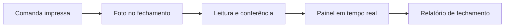
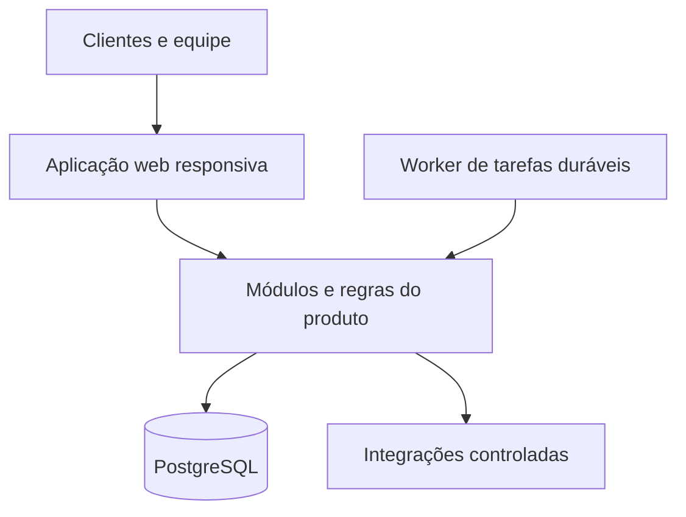

# ComandaFácil

**Do papel ao digital, mais clareza no atendimento e no fechamento.**

Plataforma modular para estabelecimentos e eventos que precisam organizar comandas, acompanhar a operação e construir relacionamento com seus clientes.

[Conheça a plataforma](#a-plataforma) · [Origem no Batuara](#origem-no-batuara) · [Design e experiência](#design-e-experiencia) · [Arquitetura](#arquitetura) · [Colaboração](#quer-colaborar-com-o-comandafácil)

**Produto proprietário · Design system aprovado · MVP em preparação**

O ComandaFácil reúne controle de consumo, atendimento e fidelidade em uma plataforma configurada para cada estabelecimento. A proposta permite começar pelas necessidades atuais do negócio e combinar recursos conforme sua operação.

> **Estado atual:** a experiência de origem com comandas impressas foi realizada no Batuara. O design system e os protótipos apresentados estão aprovados como referência visual. A arquitetura inicial está especificada; a implementação funcional do novo MVP e sua homologação de produção ainda serão realizadas. As capacidades abaixo descrevem o produto definido, não serviços já disponíveis para contratação.

## Uma plataforma que acompanha o atendimento

Restaurantes, bares, cafeterias, lanchonetes e eventos têm rotinas diferentes. O ComandaFácil organiza os recursos em módulos para que cada estabelecimento use a composição adequada ao seu serviço.

| Frente | O que o estabelecimento poderá fazer |
|---|---|
| **Comandas impressas** | Manter o papel na operação, registrar manualmente ou fotografar as comandas no fechamento, conferir a leitura assistida e consolidar os resultados |
| **Comandas digitais** | Organizar o consumo individual ou compartilhado, acompanhar pedidos e manter o histórico do atendimento |
| **Cardápio digital** | Apresentar categorias, preços e foto opcional dos produtos, com acesso pelo navegador do celular |
| **Recepção e salão** | Acompanhar espera, grupos, mesas, acomodação e disponibilidade |
| **Cozinha** | Visualizar o que precisa ser produzido e registrar preparo e liberação para retirada |
| **Garçom e Cumim** | Distribuir pedidos, retirada, entrega e organização do salão conforme os papéis e permissões do estabelecimento |
| **Caixa e fechamento** | Conferir comandas, dividir valores, registrar recebimentos e gerar resumos e relatório de fechamento |
| **Saída** | Conferir a saída de clientes conforme as regras do estabelecimento e acompanhar a liberação física do salão |
| **Fidelidade digital** | Oferecer cartões com identidade própria, registrar visitas elegíveis e disponibilizar benefícios configurados pelo estabelecimento |
| **Administração** | Configurar equipe, produtos contratados, identidade visual e domínio próprio, com gestão da plataforma separada da gestão de cada negócio |

Papel, operação digital e fidelidade podem atender necessidades distintas ou trabalhar em conjunto. Produtos, módulos e permissões são configurados por estabelecimento; a contratação de um recurso não concede acesso aos demais automaticamente.

## Objetivos do produto

- Dar visibilidade ao atendimento e ao fechamento, com informações organizadas para cada função.
- Preservar a origem dos consumos, alterações e recebimentos, com histórico verificável.
- Facilitar a adoção gradual de recursos digitais em operações que já utilizam comandas impressas.
- Manter uma experiência coerente entre celular, tablet e computador.
- Permitir que cada estabelecimento apresente sua marca nos módulos contratados.
- Apoiar o relacionamento com clientes por meio de fidelidade configurável.

## A origem no Batuara

O ComandaFácil nasceu de uma experiência prática no **Batuara**, com um escopo mais simples: controle de **comandas impressas, fotografadas no momento do fechamento**.

Os dados apurados alimentavam um **painel com resultados em tempo real** e um **relatório de fechamento**. Essa experiência mostrou o valor de organizar o que estava no papel e tornar o resultado da operação acessível durante o atendimento.

A plataforma atual amplia essa ideia para uma operação modular, com atendimento digital, recepção, cozinha, equipe e fidelidade. Esses módulos pertencem à evolução do ComandaFácil; não descrevem funcionalidades utilizadas naquela experiência original do Batuara.

## Uma identidade, em todos os módulos

O **design system está aprovado** e será a referência para a implementação das interfaces.

Cada estabelecimento terá logotipo e paleta próprios, compartilhados entre seus módulos contratados. Cardápio, cartão de fidelidade, administração e operação devem parecer partes do mesmo produto daquele negócio.

| Contexto | Direção da experiência |
|---|---|
| Administração e caixa | Composições para telas largas e versões móveis próprias |
| Cliente, Garçom, Cumim, recepção e saída | Uso orientado ao celular, com ações diretas e alvos de toque adequados |
| Cozinha | Prioridade para leitura e operação em tablet, notebook ou desktop |
| Marca do estabelecimento | Logo e cores consistentes, preservando legibilidade e o significado dos estados |

Domínio próprio é uma opção prevista no MVP. A ativação dependerá da verificação do endereço e da configuração segura de DNS e HTTPS.

[Veja a galeria de interfaces](docs/showcase/README.md), com exemplos de administração e cardápio móvel.

As telas prototipadas orientam a construção do produto. Seus dados são fictícios e suas interações demonstrativas não representam integrações de produção.

## Arquitetura para uma operação consistente

O desenho inicial usa um **monólito modular**: uma solução com responsabilidades bem separadas, regras compartilhadas e transações consistentes. Aplicação web e processamento em segundo plano evoluem no mesmo ciclo de versão.

| Base tecnológica planejada | Responsabilidade |
|---|---|
| **C# e .NET / ASP.NET Core** | Regras de negócio, serviços, autenticação e endpoints |
| **Blazor Web App e MudBlazor** | Interfaces responsivas e componentes alinhados ao design system |
| **Entity Framework Core e PostgreSQL** | Persistência, transações e isolamento por estabelecimento |
| **Web e Worker** | Atendimento interativo e processamento durável de tarefas |
| **Docker e Compose** | Execução local e organização reproduzível dos serviços |
| **OpenTelemetry, xUnit e Playwright** | Observabilidade e validação progressiva da implementação |

O ambiente é multi-tenant: os estabelecimentos compartilham a plataforma, com contexto, permissões e dados isolados. O desenho combina validação no servidor, transações, filtros de dados e Row-Level Security no PostgreSQL.

Totais, descontos e recebimentos seguem regras determinísticas da aplicação. A leitura assistida por IA sugere informações da fotografia; o operador confere, e o sistema valida os valores.

## Desenvolvimento e evolução

O projeto segue um fluxo de **requisito → especificação → tarefa → implementação → teste → revisão**. A execução da aplicação e de suas dependências durante o desenvolvimento acontece em **Docker local**, com uma topologia representativa da produção.

| Etapa | Situação |
|---|---|
| Experiência de origem no Batuara | Realizada, no recorte de comandas impressas e fechamento por foto |
| Design system e protótipos | Aprovados como referência visual |
| Arquitetura e fundação | Especificadas, com tarefas e critérios de aceite definidos |
| Módulos funcionais do novo produto | Implementação e contratos detalhados em preparação |
| Produção comercial | Ainda não homologada |

A evolução prioriza os fluxos completos do estabelecimento, preservando isolamento, autoria, consistência financeira e recuperação diante de falhas. As integrações serão habilitadas após suas verificações técnicas.

## Quer colaborar com o ComandaFácil?

Tem interesse em participar da construção do projeto? Queremos conversar com pessoas das áreas de desenvolvimento, design, qualidade e validação da operação em estabelecimentos.

Apresente sua área de atuação, experiência e como gostaria de colaborar. As possibilidades serão avaliadas individualmente, com escopo e responsabilidades definidos em conjunto.

O projeto permanece proprietário. A participação na equipe e o acesso ao repositório privado são concedidos por convite, após o alinhamento da colaboração.

**[Entre em contato para colaborar](https://guelfi.com.br/#contato)**

## Produto proprietário

O **ComandaFácil é um produto comercial proprietário**, sem proposta de distribuição open source.

Esta apresentação pública descreve o produto e suas escolhas arquiteturais. O uso comercial, a distribuição do código e o acesso aos materiais internos dependem das condições expressamente estabelecidas pelo titular. Bibliotecas e demais materiais de terceiros conservam suas respectivas licenças.

Consulte o [aviso sobre o projeto](NOTICE.md).

---

**ComandaFácil** — clareza para atender, acompanhar e fechar.

[Voltar à apresentação](#comandafácil)
