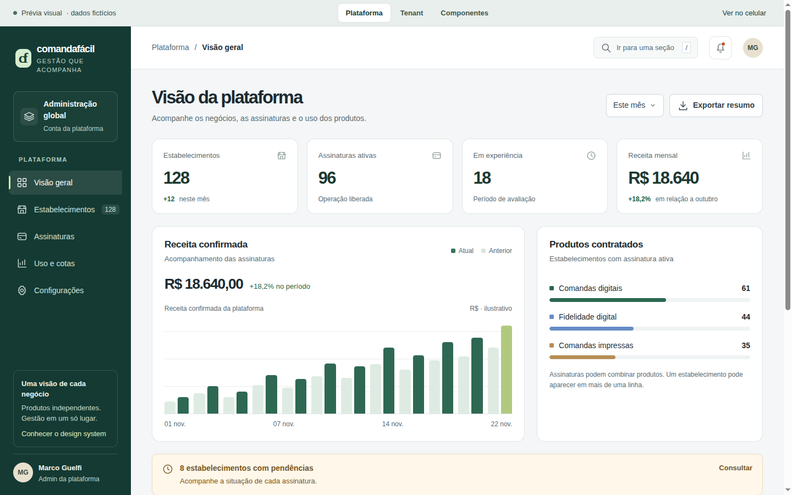
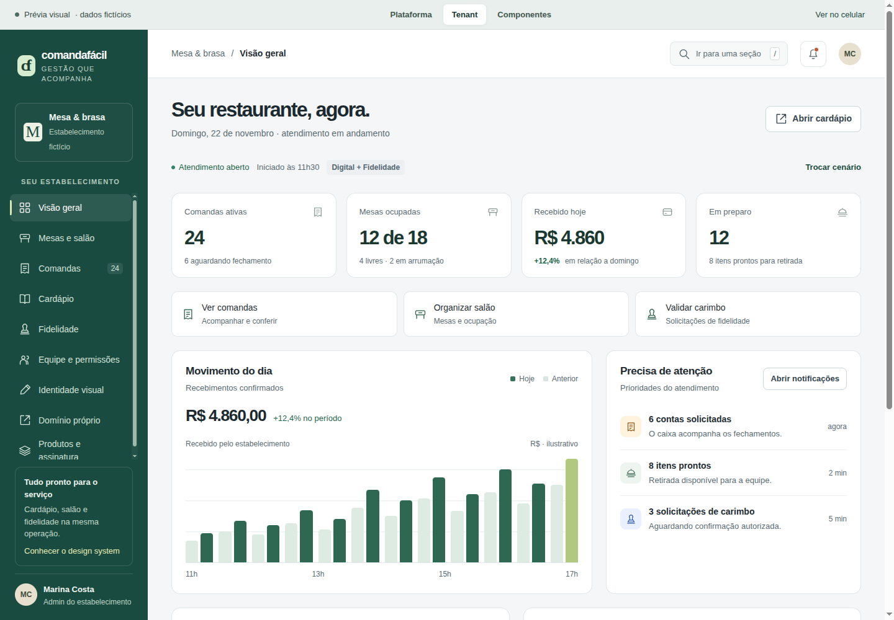
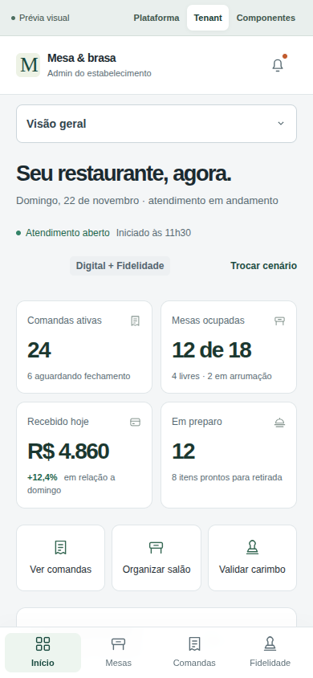
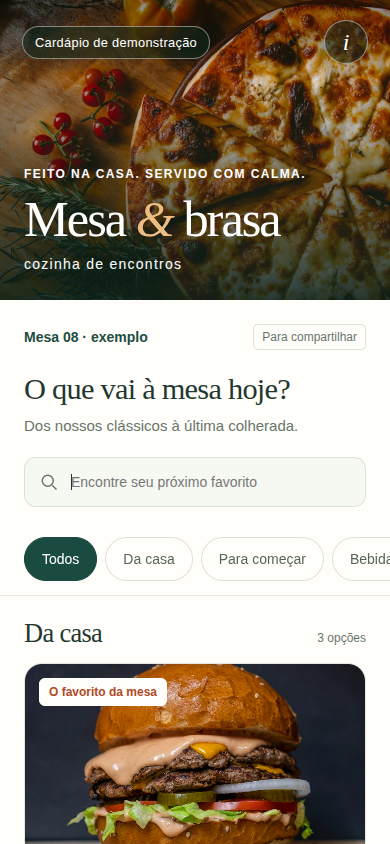

# Galeria de interfaces do ComandaFácil

Recorte público dos protótipos que orientam o design system aprovado. **São prévias com dados fictícios, não telas de um serviço comercial já em produção.** Valores, quantidade de clientes, estabelecimentos e receitas exibidos não representam resultados do projeto.

O produto combina interfaces para computador, tablet e celular. A marca do estabelecimento acompanha seus módulos; a administração global mantém a identidade da plataforma.

## Administração da plataforma

Visão agregada de estabelecimentos, assinaturas e uso. A galeria emprega nomenclatura genérica para apresentar as frentes do produto.

## Administração do estabelecimento

Visão do atendimento, mesas, recebimentos e solicitações. Na tela larga, o cartão informativo e o usuário permanecem no rodapé lateral; a navegação tem rolagem própria.

## Operação no celular e cardápio

As composições móveis priorizam navegação e ações ao alcance do toque. O cardápio apresenta categorias, busca, preço e foto opcional por produto.

  
  

## Limites da demonstração

As imagens apresentam a direção visual, sem expor as fontes completas ou os documentos internos. Pagamentos, autorização, domínio próprio, mensagens e operações financeiras dependem da implementação e validação do MVP. Não há coleta de dados ou execução de operações a partir destas capturas estáticas.

O nome Mesa & brasa e os dados exibidos pertencem ao cenário fictício de demonstração. As fotografias do cardápio são exemplos obtidos do Unsplash, sem relação com produtos reais do Batuara. Fontes visíveis nesta captura: [pizza de exemplo](https://images.unsplash.com/photo-1513104890138-7c749659a591) e [hambúrguer de exemplo](https://images.unsplash.com/photo-1568901346375-23c9450c58cd). Seus direitos permanecem com os respectivos titulares.

[Voltar à apresentação do projeto](../../README.md) · [Conversar sobre colaboração](https://guelfi.com.br/#contato)
